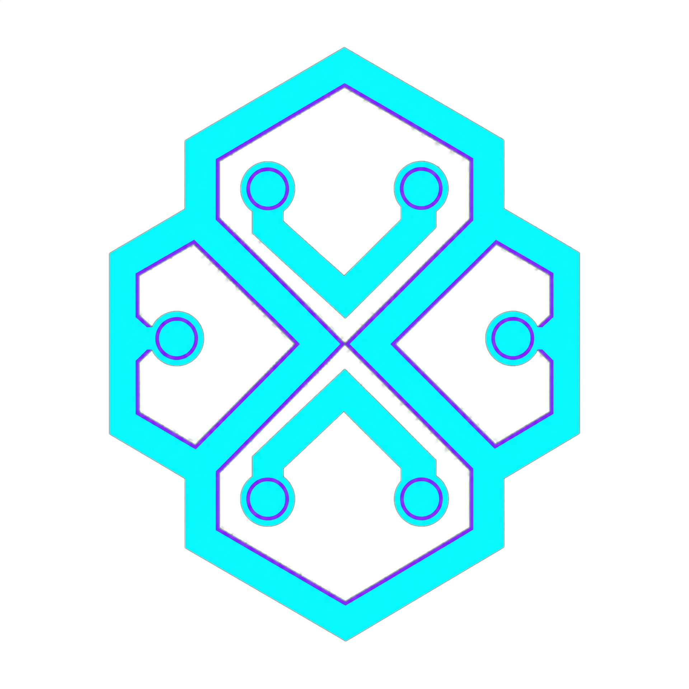
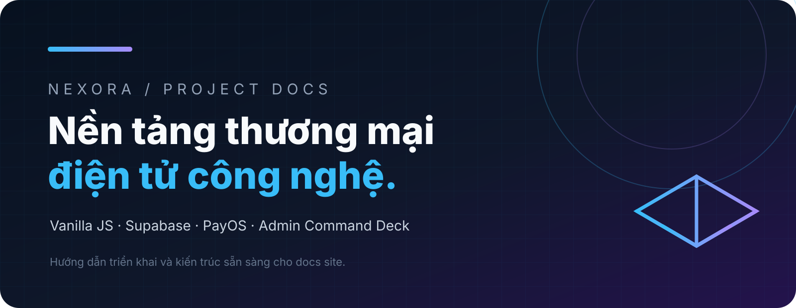
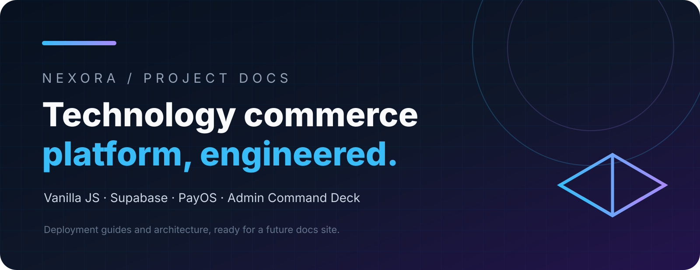
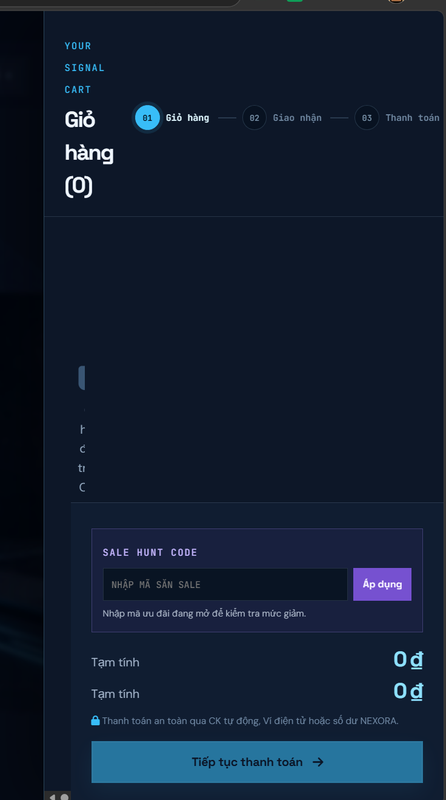

import { Card, CardGrid } from '@astrojs/starlight/components';

## Logo

`nexora-logo.png`: official logo copied from `client/public/media/nexora-logo_3c03446b.png`, the same asset used by the storefront.

## Banner

- `nexora-project-banner-vi.svg`: Vietnamese project introduction banner.
- `nexora-project-banner-en.svg`: English project introduction banner.

## Demo

:::caution[Note]
Keep source-controlled assets free of customer data, private keys, and production-only URLs.
:::
