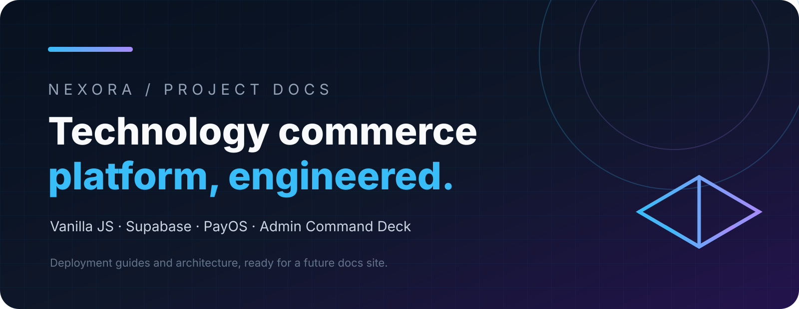

import { Card, CardGrid, LinkCard } from '@astrojs/starlight/components';

## Pick a topic

<CardGrid>
  <Card title="Getting started" icon="rocket">
    Clone, install dependencies, configure Supabase and run locally.

    [Open page →](/en/getting-started/)
  </Card>
  <Card title="Deployment" icon="cloud-download">
    Render, aaPanel, cPanel, static hosting and the production checklist.

    [Open page →](/en/deployment/)
  </Card>
  <Card title="Supabase" icon="seti:db">
    Canonical schema, Auth, RLS, RPCs and Storage.

    [Open page →](/en/supabase/)
  </Card>
  <Card title="Admin" icon="setting">
    Command Deck, roles, capabilities, CMS and sale campaigns.

    [Open page →](/en/admin/)
  </Card>
  <Card title="Payments" icon="approve-check">
    PayOS, automatic bank transfer, QR payments and e-wallets.

    [Open page →](/en/payments/)
  </Card>
  <Card title="Email & security" icon="email">
    SMTP/Resend, password recovery, secrets and production safety.

    [Open page →](/en/email-security/)
  </Card>
</CardGrid>

## Detailed references

Full legacy guides stay available so existing links keep working.

<CardGrid>
  <LinkCard title="Deployment & user guide" description="Local setup, hosting options, roles, payments and troubleshooting" href="/en/reference/deployment-guide/" />
  <LinkCard title="PayOS" description="Signed webhooks, sandbox and troubleshooting" href="/en/reference/payos-setup/" />
  <LinkCard title="SMTP & Email" description="SMTP / Resend, DNS, password reset and security" href="/en/reference/smtp-setup/" />
  <LinkCard title="Render Environment" description="Build/start commands, env variables and health check" href="/en/reference/render-env/" />
  <LinkCard title="Supabase Storage" description="Admin image bucket, policies and public URLs" href="/en/reference/supabase-storage/" />
</CardGrid>
