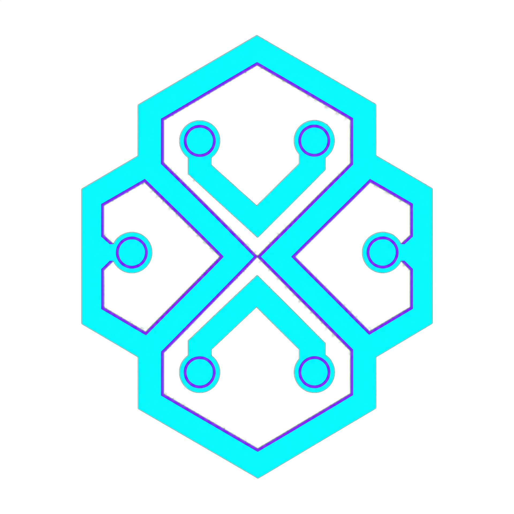
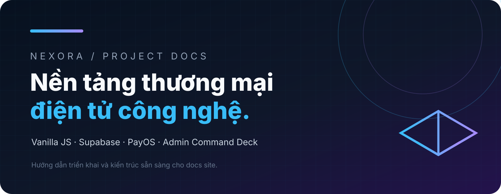
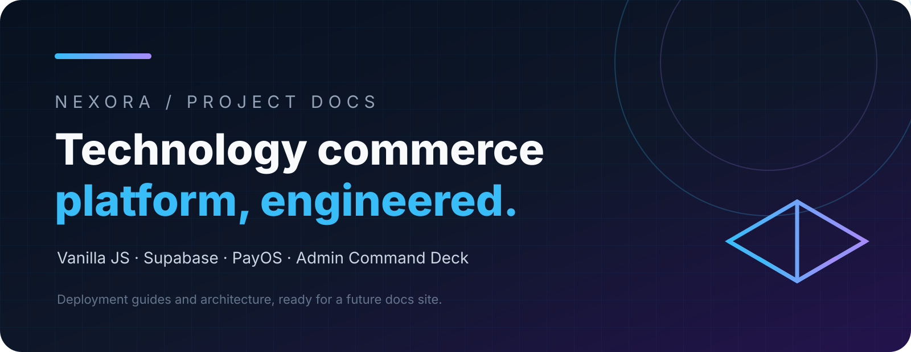
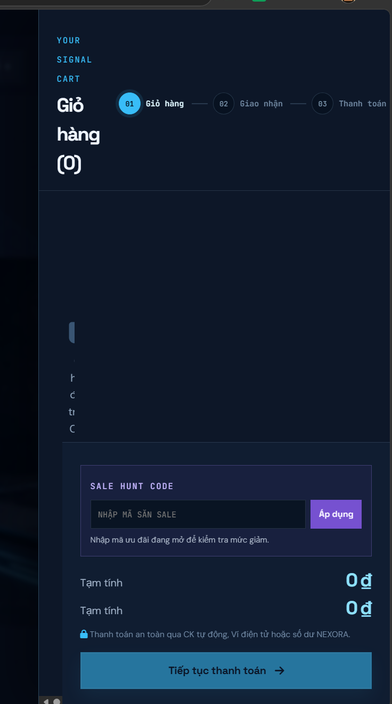

import { Card, CardGrid } from '@astrojs/starlight/components';

## Logo

`nexora-logo.png`: logo chính thức, copy nguyên bản từ `client/public/media/nexora-logo_3c03446b.png` đang dùng trên storefront.

## Banner

- `nexora-project-banner-vi.svg`: banner giới thiệu project tiếng Việt.
- `nexora-project-banner-en.svg`: banner giới thiệu project tiếng Anh.

## Demo

:::caution[Lưu ý]
Giữ asset trong source control sạch: không có dữ liệu khách hàng, private key hoặc URL chỉ dùng cho production.
:::
