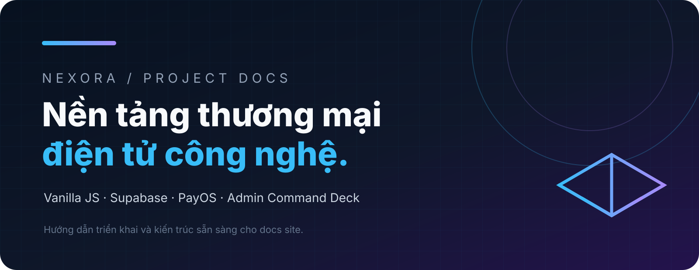

import { Card, CardGrid, LinkCard } from '@astrojs/starlight/components';

## Chọn theo nhu cầu

<CardGrid>
  <Card title="Bắt đầu" icon="rocket">
    Clone, cài dependency, cấu hình Supabase và chạy local.

    [Mở trang →](/vi/getting-started/)
  </Card>
  <Card title="Triển khai" icon="cloud-download">
    Render, aaPanel, cPanel, static hosting và checklist production.

    [Mở trang →](/vi/deployment/)
  </Card>
  <Card title="Supabase" icon="seti:db">
    Schema canonical, Auth, RLS, RPC và Storage.

    [Mở trang →](/vi/supabase/)
  </Card>
  <Card title="Admin" icon="setting">
    Command Deck, role, capability, CMS và vận hành sale campaign.

    [Mở trang →](/vi/admin/)
  </Card>
  <Card title="Thanh toán" icon="approve-check">
    PayOS, chuyển khoản tự động, QR và ví điện tử.

    [Mở trang →](/vi/payments/)
  </Card>
  <Card title="Email & bảo mật" icon="email">
    SMTP/Resend, recovery password, secrets và an toàn production.

    [Mở trang →](/vi/email-security/)
  </Card>
</CardGrid>

## Tài liệu chi tiết

Các hướng dẫn đầy đủ được giữ nguyên để không gãy liên kết cũ.

<CardGrid>
  <LinkCard title="Hướng dẫn A–Z" description="Clone, Supabase, admin, aaPanel, cPanel và checklist production" href="/vi/reference/guide-a-z/" />
  <LinkCard title="PayOS" description="Webhook xác minh chữ ký, sandbox và xử lý sự cố" href="/vi/reference/payos-setup/" />
  <LinkCard title="SMTP & Email" description="SMTP / Resend, DNS, reset password và bảo mật" href="/vi/reference/smtp-setup/" />
  <LinkCard title="Render Environment" description="Blueprint, biến môi trường và health check" href="/vi/reference/render-env/" />
  <LinkCard title="Supabase Storage" description="Bucket ảnh Admin, policy và public URL" href="/vi/reference/supabase-storage/" />
</CardGrid>
